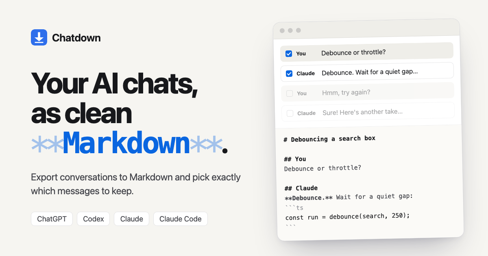

# Chatdown

Chrome extension that exports ChatGPT, Codex, Claude and Claude Code conversations to Markdown (or HTML, PDF, plain text and JSON), letting you pick exactly which messages to include.

**[Website and live demo](https://djui.github.io/chatdown/)** · **[Download](https://github.com/djui/chatdown/releases/latest)**



## Install

1. Download `chatdown-x.y.z.zip` from the [latest release](https://github.com/djui/chatdown/releases/latest) and unzip it.
2. Open `chrome://extensions` and enable **Developer mode**.
3. Click **Load unpacked** and choose the unzipped `chatdown` folder (or this repo, when developing).
4. Open a conversation and click the Chatdown toolbar icon. The export panel opens in Chrome's side panel.

Works in Chrome and other Chromium browsers (Edge, Brave, Arc).

## Use

- Every message is listed as a card. Click one to leave it out, and Shift-click to pick several at once.
- While the panel is open, each message in the chat also gets a checkbox in the margin, synced with the panel (switch off under Options → *Checkboxes in the chat*). They are drawn in an overlay; the page itself is not modified.
- Quick selects: **All**, **None**, **Yours**, the AI's answers, **Invert**.
- **Show** previews a single turn as Markdown.
- **Options**: thinking, tool use (optionally folded into `<details>`), times and model, note properties (YAML front matter), and speaker names (default: "You" and the site's name). Options persist.
- Pick a format: **Markdown**, **HTML** (one self-contained page), **PDF** (opens Chrome's print dialog; choose *Save as PDF*), **Plain text** or **JSON**.
- **Preview**, **Copy** or **Download**. In HTML and PDF mode, Copy puts formatted text on the clipboard for pasting into Docs, Notion or mail.

## How it reads conversations

| Site | URL | Method |
| --- | --- | --- |
| ChatGPT | `chatgpt.com/c/<id>` | Same-origin API (`/backend-api/conversation/<id>`), falls back to the DOM |
| Claude | `claude.ai/chat/<id>` | Same-origin API (`/api/organizations/<org>/chat_conversations/<id>`), falls back to the DOM |
| Codex | `chatgpt.com/codex/...` | DOM only (best-effort selectors) |
| Claude Code | `claude.ai/code/...` | DOM only (best-effort selectors) |

The API path exports only the active branch (edited or regenerated alternatives are skipped) and includes thinking, tool calls and tool results, artifacts, and attachments. The DOM path captures what is rendered: text, code, lists, tables, links and math. The panel shows which method was used.

All requests go to the site you are on, using your existing session. Nothing is sent anywhere else.

## Layout

```
manifest.json
src/background.js         opens the side panel on toolbar click
src/content/parsers.js    provider API JSON → normalized conversation (pure)
src/content/html2md.js    rendered DOM → Markdown (fallback)
src/content/extractors.js site detection, API fetch, DOM strategies
src/content/content.js    message handler for the panel
src/content/onpage.js     checkboxes in the chat, synced with the panel over a port
src/shared/markdown.js    turn grouping + Markdown rendering (pure)
src/shared/md2html.js     Markdown → safe HTML (escapes everything, http(s)/mailto links only)
src/shared/formats.js     HTML, PDF, plain text and JSON exports
src/print/                print page used for PDF
src/panel/                side panel UI
dev/harness.html          panel in a normal tab with stubbed chrome.* and sample data
dev/og.html               source of the social preview image
dev/page-mock.html        mock chat page with the on-page checkboxes
site/                     landing page (GitHub Pages); its demo runs parsers.js + markdown.js
```

## Develop

```bash
npm test                          # parser + renderer unit tests (node:test, no deps)
python3 -m http.server 8765       # then open http://localhost:8765/dev/harness.html[?mode=dom]
npm run site                      # landing page at http://localhost:8765
npm run package                   # dist/chatdown-<version>.zip for a release
python3 scripts/make-icons.py     # regenerate icons/
```

The landing page deploys from `site/` via `.github/workflows/pages.yml` on every push to `main` that touches it.

## License

MIT

After code changes, press reload on the extension card in `chrome://extensions`.
